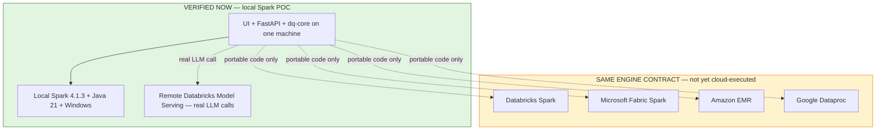
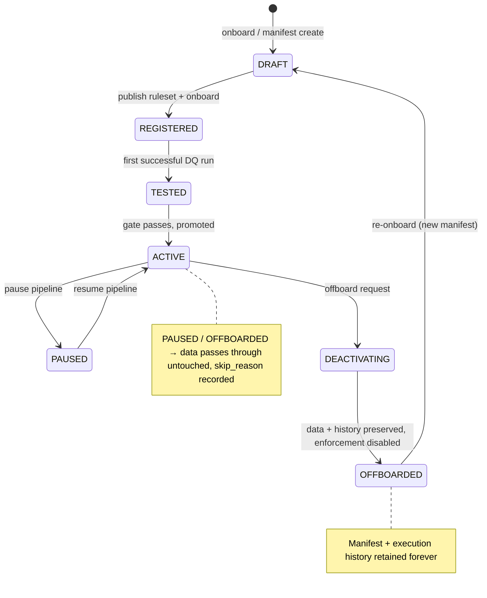
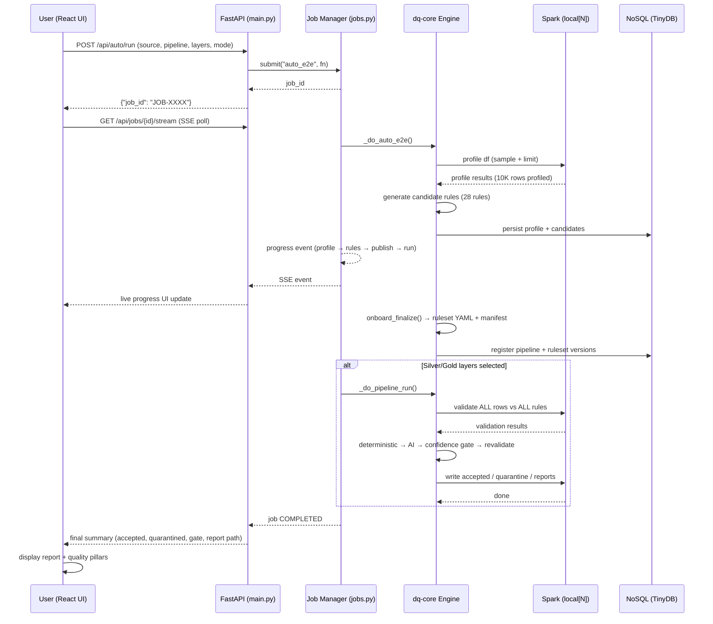

# DQ Accelerator — Architecture & Flow Presentation Guide

> **Complete end-to-end view** for team lead presentations. Covers HLD, LLD,
> data flow, control flow, and every code entry point from UI click to
> governed DQ output.
>
> **Verified scope:** local Spark POC (P0–P4 complete). Real cloud Spark run
> is the one open item — contract-proven, not executed.

---

## 0. Executive Summary — What the Application Does

The **DQ Accelerator** is a metadata-driven, Spark-native data quality framework
that drops into any existing PySpark pipeline. It profiles data, auto-generates
quality rules, lets stewards review/approve them, then runs governed
validation + remediation (deterministic + AI) across Bronze → Silver → Gold
medallion layers.

**Core contract:** `engine.run(existing_dataframe, ruleset, policy, context, mode) → DQResult`

The same code runs on Databricks, AWS EMR, Microsoft Fabric, Google Dataproc,
and standalone/local Spark — no Databricks imports anywhere in `dq-core`.

---

## 1. High-Level Design (HLD)

### 1.1 System Architecture — End to End

```mermaid
flowchart TB
    subgraph USER["User / Data Steward / Pipeline Owner"]
        U1[React UI — :5173]
        U2[dqctl CLI]
    end

    subgraph API["FastAPI Job API — :8000 (ui/backend/main.py)"]
        A1[POST /api/auto/run — one-click E2E]
        A2[POST /api/onboard/preview — profile + candidates]
        A3[POST /api/onboard/finalize — publish ruleset]
        A4[POST /api/pipelines/{id}/run — governed DQ]
        A5[GET /api/jobs/{id}/stream — SSE live progress]
        A6[GET /api/quarantine/pending — approval inbox]
    end

    subgraph JOB["Job Manager (ui/backend/jobs.py)"]
        J1[SQLite job store — data/jobs.db]
        J2[Thread-pool worker per job]
        J3[Spark session singleton — local[N]]
    end

    subgraph CORE["dq-core Engine (packages/dq-core/src/dq_core)"]
        E1[DataQualityEngine facade]
        E2[Profiler — FULL / SAMPLE / APPROXIMATE]
        E3[CandidateRuleGenerator]
        E4[ValidationEngine — native PySpark exprs]
        E5[Remediation — deterministic + AI]
        E6[Revalidator + Quality Gate]
        E7[RuleSet & Pipeline registries]
        E8[Metadata store — TinyDB / MongoDB / DynamoDB]
    end

    subgraph SPARK["Apache Spark — local[N] / Databricks / EMR / Fabric / Dataproc"]
        S1[DataFrame API only — no session ownership]
        S2[Parquet / Delta sinks]
    end

    subgraph OUT["Outputs"]
        O1[data/bronze/, data/silver/, data/gold/]
        O2[data/quarantine/<stage>/]
        O3[data/audit/<stage>/]
        O4[reports/*.json]
    end

    U1 --> API
    U2 --> E1
    API --> JOB
    JOB --> CORE
    CORE --> SPARK
    CORE --> OUT
    E7 --> E1
    E8 --> E7
```

### 1.2 Deployment Boundary — Verified vs Target



> **Honest boundary:** The engine + adapters are contract-proven for all four
> cloud targets. A real cluster execution on Databricks/EMR/Fabric/Dataproc is
> the one open P4 item — needs workspace credentials, not engine changes.

---

## 2. Low-Level Design (LLD) — Layered Stack

```mermaid
flowchart TB
    subgraph L1["L1 — Integration Layer (thin, pluggable")]
        I1[dqctl CLI]
        I2[FastAPI REST + SSE]
        I3[Databricks notebook adapter]
        I4[PlatformAdapter contracts — Dataproc / Fabric / Airflow / ADF]
    end

    subgraph L2["L2 — Orchestration"]
        O1[DQRunner — mode dispatch (OBSERVE / ENFORCE / REMEDIATE)]
        O2[MedallionRunner — B → S → G chaining]
        O3[DQResult — single caller contract]
    end

    subgraph L3["L3 — Engine Core"]
        C1[DataQualityEngine — facade]
        C2[ValidationEngine — native PySpark Column expressions]
        C3[Remediation — deterministic + AI proposals]
        C4[Revalidator — post-correction check]
        C5[Confidence & sensitive-data policy]
    end

    subgraph L4["L4 — Metadata & Policy"]
        M1[RuleDefinition / RuleSet models — immutable, checksummed]
        M2[RuleSetRegistry — publish / activate / rollback / diff]
        M3[PipelineRegistry — 7-state lifecycle]
        M4[RemediationPolicyConfig — approvals + rejection memory]
    end

    subgraph L5["L5 — Runtime"]
        R1[EngineConfig — YAML-driven]
        R2[Spark session handling — never owned, always df.sparkSession]
        R3[Structured logging + typed errors]
        R4[Schema utilities]
    end

    subgraph L6["L6 — Spark Runtime"]
        S1[PySpark DataFrame API only]
        S2[Parquet / Delta output]
    end

    L1 --> L2 --> L3 --> L4 --> L5 --> L6

    style L1 fill:#e3f2fd,stroke:#1565c0
    style L2 fill:#fff3e0,stroke:#ef6c00
    style L3 fill:#f3e5f5,stroke:#7b1fa2
    style L4 fill:#e8f5e9,stroke:#2e7d32
    style L5 fill:#eceff1,stroke:#455a64
    style L6 fill:#ffebee,stroke:#c62828
```

### 2.1 Module Map — `dq-core`

```mermaid
flowchart TD
    subgraph ENG["Engine"]
        E1[engine.py — DataQualityEngine facade]
    end

    subgraph CTX["Context"]
        C1[context/__init__.py — PipelineContext, Stage, IntegrationMode, ExecutionContext]
    end

    subgraph RUNTIME["Runtime"]
        R1[config.py — EngineConfig.from_yaml]
        R2[local_spark.py — session harness]
        R3[errors.py — typed errors]
        R4[inspection.py — runtime detection]
        R5[compat.py — Spark 3.x/4.x safe]
    end

    subgraph METADATA["Metadata"]
        M1[models.py — RuleDefinition, RuleSet]
        M2[serialization.py — YAML/JSON round-trip]
        M3[store.py — TinyDB / MongoDB / DynamoDB]
    end

    subgraph RULES["Rules & Registry"]
        R1[rules/registry.py — versioned, checksummed, immutable]
        R2[diff.py — version comparison]
        R3[pipelines/registry.py — lifecycle state machine]
    end

    subgraph PROFILING["Profiling"]
        P1[profiler.py — DataProfiler (FULL/SAMPLE/APPROXIMATE)]
        P2[models.py — ProfileReport, ColumnProfile]
        P3[patterns.py — structural regex inference]
        P4[drift.py — run-over-run drift]
    end

    subgraph GENERATION["Rule Generation"]
        G1[generator.py — CandidateRuleGenerator]
    end

    subgraph VALIDATION["Validation"]
        V1[validation/engine.py — ValidationEngine]
        V2[expressions.py — native PySpark Column exprs]
        V3[columns.py — rule scope (ROW/DATASET/CROSS)]
    end

    subgraph REMEDIATION["Remediation"]
        R1[remediation/deterministic.py — TRIM/DEDUP/LOOKUP/etc.]
        R2[ai_remediation.py — AI proposal orchestration]
        R3[revalidation/revalidator.py — post-correction check]
    end

    subgraph AI["AI Provider"]
        A1[ai/base.py — AIRemediationProvider interface]
        A2[ai/mock.py — MockAIProvider, clearly labelled]
        A3[ai/dqx_provider.py — LiteLLM → Databricks Model Serving]
    end

    subgraph POLICIES["Policies"]
        P1[policies/confidence.py — 90% threshold, boundary-tested]
        P2[policies/models.py — RemediationPolicyConfig]
        P3[policies/approvals.py — ApprovalStore, RejectionStore]
    end

    subgraph QUARANTINE["Quarantine"]
        Q1[quarantine/builder.py — dq_* columns, status taxonomy]
    end

    subgraph ORCHESTRATION["Orchestration"]
        O1[orchestration/runner.py — DQRunner, mode dispatch]
        O2[orchestration/medallion.py — MedallionRunner B/S/G]
        O3[orchestration/result.py — DQResult contract]
        O4[orchestration/gate.py — quality gate]
    end

    subgraph IO["I/O"]
        I1[io/sources.py — CSV/Parquet/JSON/DELTA/TABLE readers]
        I2[io/sinks.py — StorageSink, StoragePaths]
    end

    subgraph METRICS["Metrics & Reports"]
        ME1[reporting/metrics.py — ExecutionMetrics]
        ME2[reporting — JSON report writer]
    end

    subgraph CLI["CLI — dqctl"]
        CL1[cli/main.py — pipeline / ruleset / bootstrap / run / profile]
    end

    E1 --> C1 & R1 & M1 & R1 & P1 & G1 & V1 & R1 & A1 & P1 & Q1 & O1 & ME1 & CL1
```

---

## 3. Data Flow Diagrams

### 3.1 Auto E2E — One-Click Onboarding (Bronze-only or Full)

```mermaid
flowchart TD
    subgraph UI["Frontend — React SPA (:5173)"]
        U1[User selects: source file, pipeline ID,<br/>mode (REMEDIATE), layers (BRONZE/SILVER/GOLD)]
        U2[Clicks "▶ Run Auto E2E"]
    end

    subgraph API["FastAPI Backend (:8000)"]
        A1[POST /api/auto/run — main.py:1766]
        A2[J.submit("auto_e2e", ...) — jobs.py]
        A3[_do_auto_e2e() — main.py:1812]
    end

    subgraph PROFILE["Profiling Phase"]
        P1[_do_bootstrap_preview() — main.py:1983]
        P2[_auto_profile_config() — main.py:699<br/>DQX-style: sample 30%, limit 10K for >500MB]
        P3[engine.profile() — engine.py:94]
        P4[DataProfiler — profiler.py<br/>Spark jobs: stats, duplicates, patterns, outliers]
        P5[CandidateRuleGenerator — generator.py<br/>28 rule candidates w/ confidence + evidence]
    end

    subgraph PUBLISH["Publish Phase"]
        B1[onboard_finalize() — main.py:2052+]
        B2[Write ruleset YAML: config/rulesets/*.yaml]
        B3[Write manifest YAML: config/pipelines/*.yaml]
        B4[Register pipeline: registry/pipelines]
        B5[Publish to NoSQL: ruleset_index, ruleset_versions]
    end

    subgraph VALIDATE["Validation Phase (Silver/Gold only)"]
        V1[_do_pipeline_run() — main.py:1895]
        V2[MedallionRunner — medallion.py]
        V3[BRONZE: ingest raw + _ingest.json lineage]
        V4[SILVER: validate ALL rows vs ALL rules]
        V5[REMEDIATE: deterministic → AI → confidence gate → revalidate → quarantine]
        V6[GOLD: ENFORCE business rules on Silver-accepted]
    end

    subgraph OUT["Outputs"]
        O1[data/bronze/, data/silver/, data/gold/]
        O2[data/quarantine/<stage>/]
        O3[data/audit/<stage>/_remediation_log]
        O4[reports/*.json — pillars, outcomes, metrics]
    end

    UI --> A1
    A1 --> A2
    A2 --> A3
    A3 --> P1
    P1 --> P2
    P2 --> P3
    P3 --> P4
    P4 --> P5
    P5 --> B1
    B1 --> B2
    B2 --> B3
    B3 --> B4
    B4 --> B5
    B5 -->|if SILVER/GOLD| V1
    V1 --> V2
    V2 --> V3
    V3 --> V4
    V4 --> V5
    V5 --> V6
    V6 --> O1
    O1 --> O2
    O2 --> O3
    O3 --> O4

    style UI fill:#e1f5e1,stroke:#2e7d32
    style API fill:#e3f2fd,stroke:#1565c0
    style PROFILE fill:#fff3e0,stroke:#ef6c00
    style PUBLISH fill:#f3e5f5,stroke:#7b1fa2
    style VALIDATE fill:#ffebee,stroke:#c62828
    style OUT fill:#eceff1,stroke:#455a64
```

### 3.2 Profiling — DQX-Style Sample-then-Limit

```mermaid
flowchart TD
    subgraph INPUT["Input"]
        I1[Source file — CSV / Parquet / JSON / DELTA / TABLE]
        I2[File size check]
    end

    subgraph CONFIG["Auto-Detect Config — _auto_profile_config()"]
        C1["< 50 MB → FULL mode, no sample, no limit"]
        C2["50–100 MB → SAMPLE 5%, limit 100K rows"]
        C3["100–500 MB → SAMPLE 10%, limit 50K rows"]
        C4["> 500 MB → APPROXIMATE 30%, limit 10K rows<br/>(DQX: sample 30%, cap profiled rows)"]
    end

    subgraph READ["Read Path"]
        R1[_read_for_profiling()]
        R2["CSV > 50 MB → temp Parquet (10–50x faster columnar read)"]
        R3[Parquet cleaned up in finally block]
    end

    subgraph PROFILE["Profiler — DataProfiler.profile()"]
        PR1[Sample: df.sample(fraction, seed)]
        PR2[Limit: df.limit(limit_rows) ← DQX cap]
        PR3[Persist: MEMORY_AND_DISK]
        PR4[Spark jobs:<br/>• schema/type sniffing<br/>• structural stats (null%, distinct, min/max, pctiles)<br/>• duplicate rows<br/>• value frequencies / top values<br/>• structural patterns<br/>• outlier analysis]
    end

    subgraph OUTPUT["Output — ProfileReport"]
        O1[row_count, column_count, schema, mode, sample_fraction, limit_rows]
        O2[per-column: null%, distinct, min/max, mean, stddev, top_values, patterns, anomalies]
        O3[dataset-level: duplicate_rows, pk_candidates, anomalies[], spark_jobs count, duration_ms]
    end

    INPUT --> I2
    I2 --> CONFIG
    CONFIG --> R1
    R1 --> R2
    R2 --> R3
    R3 --> PR1
    PR1 --> PR2
    PR2 --> PR3
    PR3 --> PR4
    PR4 --> O1
    O1 --> O2
    O2 --> O3

    style CONFIG fill:#fff3e0,stroke:#ef6c00
    style PROFILE fill:#e3f2fd,stroke:#1565c0
```

### 3.3 Validation & Remediation — REMEDIATE Mode

```mermaid
flowchart TD
    subgraph INPUT["Input"]
        I1[Silver-accepted DataFrame or raw Bronze frame]
        I2[Silver ruleset (published, checksummed, immutable)]
        I3[RemediationPolicyConfig — 90% threshold, sensitive columns]
    end

    subgraph VALIDATE["Validate — ValidationEngine"]
        V1[Native PySpark Column expressions — no eval()/generated code]
        V2[Per-rule: total / passed / failed / pass_pct / failure_reasons / examples]
        V3[Row-level + dataset-level + cross-dataset rules]
        V4[Accumulate multiple violations per record as a list]
    end

    subgraph DET["Deterministic Remediation"]
        D1[TRIM / UPPERCASE / LOWERCASE / LOOKUP_MAPPING / DATE_STANDARDIZATION / NULL_REPLACEMENT / DEDUPLICATE]
        D2[Policy-permitted actions only]
        D3[Every fix records: original value, action, rule ID → audit]
    end

    subgraph AI["AI Proposals — DQXProvider / MockAI"]
        A1[Batched by distinct (rule, column, value) — never one call per row]
        A2[Confidence ≥ 0.90 → eligible for auto-apply]
        A3[Sensitive column → requires human approval regardless of confidence]
        A4[Below 0.90 → quarantine (BELOW_CONFIDENCE_THRESHOLD)]
    end

    subgraph DECISION["Decision — ConfidencePolicyEngine"]
        DE1[AUTO_APPLY: ≥ threshold, non-sensitive]
        DE2[PENDING_HUMAN_APPROVAL: sensitive column regardless of confidence]
        DE3[BELOW_CONFIDENCE_THRESHOLD: < threshold]
        DE4[ApprovalStore / RejectionStore — memory persists]
    end

    subgraph REVALIDATE["Revalidate — Revalidator"]
        R1[Re-run failed rules against corrected rows]
        R2[Clean → accepted]
        R3[Still failing → quarantine (CORRECTION_FAILED_REVALIDATION)]
    end

    subgraph OUTPUT["Output"]
        O1[accepted DataFrame → data/silver/ or data/gold/]
        O2[quarantine DataFrame with dq_* columns]
        O3[outcome_audit — all 7 terminal outcomes]
        O4[reports/*.json — quality_pillars (7 scores), metrics]
    end

    INPUT --> V1
    V1 --> V2
    V2 --> V3
    V3 --> V4
    V4 --> D1
    D1 --> D2
    D2 --> D3
    D3 --> A1
    A1 --> A2
    A2 --> A3
    A3 --> A4
    A4 --> DE1
    DE1 --> DE2
    DE2 --> DE3
    DE2 --> DE4
    DE1 --> R1
    DE2 --> R1
    DE3 --> O2
    DE4 --> O2
    R1 --> R2
    R1 --> R3
    R2 --> O1
    R3 --> O2
    O1 --> O3
    O2 --> O3
    O3 --> O4

    style INPUT fill:#e1f5e1,stroke:#2e7d32
    style VALIDATE fill:#e3f2fd,stroke:#1565c0
    style DET fill:#f3e5f5,stroke:#7b1fa2
    style AI fill:#fff3e0,stroke:#ef6c00
    style DECISION fill:#ffebee,stroke:#c62828
    style REVALIDATE fill:#e3f2fd,stroke:#1565c0
    style OUTPUT fill:#eceff1,stroke:#455a64
```

### 3.4 Medallion Flow — Bronze → Silver → Gold

```mermaid
flowchart TD
    subgraph BRZ["BRONZE — Preserve & Profile"]
        B1[raw_df (input, unchanged)]
        B2[write to data/bronze/<dataset>/ — parquet]
        B3[write _ingest.json — checksum, schema, row count, timestamp]
        B4[engine.profile() → candidate rules]
        B5[CANDIDATE RuleSet — review → publish → activate]
    end

    subgraph SLV["SILVER — Validate & Remediate"]
        S1[Bronze-accepted DataFrame]
        S2[Silver ruleset @active]
        S3[engine.run(mode=REMEDIATE)]
        S4[accepted → data/silver/<dataset>/]
        S5[quarantine → data/quarantine/silver/<dataset>/]
        S6[audit → data/audit/silver/<dataset>_remediation_log]
        S7[report → reports/*.json]
    end

    subgraph GLD["GOLD — Business Rules & Publish"]
        G1[Silver-accepted DataFrame only]
        G2[Gold ruleset @active — provided separately, NOT auto-copied]
        G3[engine.run(mode=ENFORCE) + reference_data for referential integrity]
        G4[accepted → data/gold/<dataset>/]
        G5[quarantine → data/quarantine/gold/<dataset>/]
        G6[report → reports/*.json]
    end

    B1 --> B2
    B2 --> B3
    B3 --> B4
    B4 --> B5
    B5 --> S1
    S1 --> S2
    S2 --> S3
    S3 --> S4
    S3 --> S5
    S3 --> S6
    S3 --> S7
    S4 --> G1
    G1 --> G2
    G2 --> G3
    G3 --> G4
    G3 --> G5
    G3 --> G6

    style BRZ fill:#e1f5e1,stroke:#2e7d32
    style SLV fill:#e3f2fd,stroke:#1565c0
    style GLD fill:#f3e5f5,stroke:#7b1fa2
```

### 3.5 Ruleset Versioning — Publish / Activate / Rollback / Diff

```mermaid
flowchart TD
    subgraph AUTHOR["Author / Generate"]
        W1[Candidate rules from profiling (wizard / CLI bootstrap)]
        W2[Steward review — approve / reject / edit per rule]
        W3[Publish as immutable v1.0 — checksum sealed]
    end

    subgraph REGISTRY["RuleSet Registry"]
        R1[ruleset_index — one doc per ruleset_id]
        R2[ruleset_versions — one doc per ruleset@version]
        R3[active_version pointer]
    end

    subgraph DIFF["Diff & Compare"]
        D1[Two version dropdowns — any vs any (v1.0 vs v1.3)]
        D2[Added / removed / modified / unchanged counts]
        D3[Checksum + metadata change detection]
    end

    subgraph ACTIVATE["Activate / Rollback"]
        A1[Set active version dropdown]
        A2[Rollback-to-version picker — replaces old "rollback previous"]
        A3[Immutable — no content change under existing version]
    end

    subgraph USE["Use in Pipeline"]
        U1[Pipeline manifest references ruleset@active or @version]
        U2[DQ run validates against exact version]
    end

    W1 --> W2
    W2 --> W3
    W3 --> R1
    R1 --> R2
    R2 --> R3
    R2 --> D1
    D1 --> D2
    D2 --> D3
    R3 --> A1
    A1 --> A2
    A2 --> A3
    A3 --> U1
    U1 --> U2

    style AUTHOR fill:#e1f5e1,stroke:#2e7d32
    style REGISTRY fill:#e3f2fd,stroke:#1565c0
    style DIFF fill:#fff3e0,stroke:#ef6c00
    style ACTIVATE fill:#f3e5f5,stroke:#7b1fa2
    style USE fill:#eceff1,stroke:#455a64
```

### 3.6 Pipeline Lifecycle — 7-State Machine



### 3.7 API / UI Control Flow



---

## 4. Data Contracts

### 4.1 PipelineContext

| Field | Description |
|-------|-------------|
| `pipeline_id` | Unique pipeline identifier |
| `pipeline_run_id` | Unique run identifier |
| `dataset` | Dataset name |
| `stage` | BRONZE / SILVER / GOLD |
| `platform` | LOCAL / DATABRICKS / FABRIC / EMR / DATAPROC |
| `runtime` | Spark version |
| `ruleset_version` | Optional pinned version |
| `integration_mode` | OBSERVE_ONLY / ENFORCE / REMEDIATE |

### 4.2 DQResult — Single Caller Contract

```python
DQResult:
  accepted_dataframe      → DataFrame that passed all rules
  quarantine_dataframe    → DataFrame with dq_* audit columns
  validation_results      → per-rule: total/passed/failed/pass_pct/failure_reasons/examples
  remediation_results     → outcome_audit counts + per-record fix/proposal log
  execution_metrics       → 30+ fields: durations, AI decisions, remediation stats
  quality_gate            → gate_passed flag + reason
  final_validation_results → post-remediation validation (REMEDIATE mode)
  profile                 → ProfileReport (when profile=True)
  to_dict() / write_report() / summary_text()
```

### 4.3 Quarantine Row — `dq_*` Audit Columns

| Column | Meaning |
|--------|---------|
| `dq_run_id` | Execution run identifier |
| `dq_pipeline_id` | Pipeline identifier |
| `dq_dataset_id` | Dataset identifier |
| `dq_stage` | BRONZE / SILVER / GOLD |
| `dq_ruleset_ref` | ruleset@version used |
| failed rule IDs | Which rules failed |
| failure reasons | Human-readable reasons per rule |
| proposed correction | AI or deterministic proposed value |
| confidence | AI confidence score (0–1) |
| `dq_remediation_status` | Terminal outcome (see below) |
| timestamps | Created, processed |

### 4.4 Terminal Outcome Taxonomy

| Outcome | Meaning |
|---------|---------|
| `OBSERVED_ONLY` | Flagged, not modified (OBSERVE_ONLY mode) |
| `UNRESOLVED_NO_SAFE_REMEDIATION` | No deterministic or AI fix available |
| `BELOW_CONFIDENCE_THRESHOLD` | AI confidence < 0.90 |
| `PENDING_HUMAN_APPROVAL` | Sensitive column awaiting steward approval |
| `CORRECTION_FAILED_REVALIDATION` | Fix applied but still fails rules |
| `DEDUPLICATE_REMOVED` | Duplicate row removed |
| `REJECTED_BY_HUMAN` | Steward rejected — permanent, never resurfaces |

### 4.5 Quality Pillars (7 Scores)

| Pillar | What it measures |
|--------|-----------------|
| Completeness | Null rate across required columns |
| Uniqueness | Duplicate row / column uniqueness |
| Validity | Format / type / range conformance |
| Consistency | Cross-field / cross-dataset consistency |
| Accuracy | Value correctness vs reference data |
| Timeliness | Freshness / SLA compliance |
| Integrity | Referential integrity / PK-FK validity |

---

## 5. Entry Points — Where the App Starts

### 5.1 Application Startup

```
DQ_start.bat (repo root)
  ├─ Checks Python 3.12+, Java 17+, Node 18+
  ├─ Loads .env secrets (DATABRICKS_TOKEN, etc.)
  ├─ Installs pip dependencies
  ├─ Starts backend: uvicorn main:app --app-dir ui/backend :8000
  └─ Starts frontend: npm run dev :5173
```

### 5.2 Code Entry Points (file:line)

| Entry Point | File | Line | Purpose |
|-------------|------|------|---------|
| App startup | `DQ_start.bat` | 1 | Single entry point for Windows |
| FastAPI app | `ui/backend/main.py` | 71 | `app = FastAPI(...)` |
| Auto E2E endpoint | `ui/backend/main.py` | 1766 | `POST /api/auto/run` → `_do_auto_e2e()` |
| Auto E2E orchestrator | `ui/backend/main.py` | 1812 | `_do_auto_e2e()` — full flow |
| Bootstrap preview | `ui/backend/main.py` | 1983 | `_do_bootstrap_preview()` — profile + candidates |
| Auto-detect profile config | `ui/backend/main.py` | 699 | `_auto_profile_config()` — file-size thresholds |
| Large CSV reader | `ui/backend/main.py` | 1952 | `_read_for_profiling()` — CSV→Parquet |
| Finalize (publish) | `ui/backend/main.py` | 2052+ | `onboard_finalize()` — ruleset + manifest |
| Pipeline run | `ui/backend/main.py` | 1895 | `_do_pipeline_run()` → governed DQ |
| Engine facade | `packages/dq-core/src/dq_core/engine.py` | 94 | `DataQualityEngine.profile()` |
| Profiler | `packages/dq-core/src/dq_core/profiling/profiler.py` | — | `DataProfiler.profile()` — Spark jobs |
| Rule generator | `packages/dq-core/src/dq_core/generation/generator.py` | — | `CandidateRuleGenerator.generate()` |
| Medallion runner | `packages/dq-core/src/dq_core/orchestration/medallion.py` | — | `MedallionRunner.run()` — B/S/G |
| DQRunner | `packages/dq-core/src/dq_core/orchestration/runner.py` | — | `DQRunner.run()` — mode dispatch |
| Validation engine | `packages/dq-core/src/dq_core/validation/engine.py` | — | `ValidationEngine.run()` |
| Remediation | `packages/dq-core/src/dq_core/remediation/` | — | deterministic + AI |
| CLI | `packages/dq-core/src/dq_core/cli/main.py` | — | `dqctl` — pipeline/ruleset/bootstrap/run/profile |

---

## 6. Review of Existing Documentation

The following existing docs were reviewed and are **correct and current**:

| Doc | Status | Notes |
|-----|--------|-------|
| `docs/architecture.md` | ✅ Current | HLD, LLD, execution modes, data contracts, status tracker — all accurate |
| `docs/code_flow.md` | ✅ Current | Updated with `_auto_profile_config()` replacing `_profile_mode_for()` |
| `docs/medallion_data_flow.md` | ✅ Current | Stage semantics, MedallionRunner signature, Gold checks |
| `docs/pipeline_adapters.md` | ✅ Current | Support matrix, adapter implementations, extension guide |
| `docs/spark_core_engine.md` | ✅ Current | Module-by-module LLD, public API, all components |
| `docs/profiling.md` | ✅ Current | Updated with DQX-style auto-detect + `limit_rows` |
| `docs/end_to_end_demo.md` | ✅ Current | Verified numbers, honest boundaries, demo walkthrough |
| `docs/presentation_runbook.md` | ✅ Current | Dataset guide, timing, "bigger data faster" script |
| `docs/ui_demo_guide.md` | ✅ Current | Demo steps, Q&A answers |
| `docs/POC.md` / `docs/POC_CONTEXT.md` | ✅ Current | Phase criteria, verification status |
| `docs/ROADMAP.md` | ✅ Current | P0–P5 priority plan, gap register, backlog |

**One update made:** `docs/code_flow.md` line 68 previously referenced the removed `_profile_mode_for()` — updated to `_auto_profile_config()` with DQX thresholds.

---

## 7. Honest Boundaries — What to Say in the Presentation

| Claim | Truth |
|-------|-------|
| "Runs on real Databricks Spark?" | Engine + Databricks LLM verified. **Real cluster Spark run is open** — contract-tested locally, not yet executed on cloud Spark. |
| "Real AI?" | Yes — `DQXProvider` calls Databricks Model Serving when `.env` creds + `requirements-llm.txt` installed; `simulated=false`. Without them → MockAI, `simulated=true` with SIM badge. |
| "All 8M rows profiled?" | **No.** Profiling samples 30% → caps at 10K rows (DQX-style). **Validation scans all 8M rows.** Profiling feeds rule generation only. |
| "Auto E2E skips human review?" | Yes — by design for demo (auto-approves all candidates). Manual wizard is the governed path with steward review. |
| "All rules auto-generated?" | Yes, from profiling evidence. Stewards can review/reject/edit before publishing. |
| "Production-ready?" | POC scope — no auth/RBAC/scheduling/multi-tenancy/alerting. Those are P5. |

---

## 8. Verified Evidence

| Artifact | Evidence |
|----------|----------|
| Tests | 139 passed (74 unit + 65 integration), Spark 3.5.9 ↔ 4.1.3 matrix identical |
| P4 portability | Byte-identical metrics across Spark versions, ANSI on/off, partitions 8↔32 |
| AI spectrum (goat, real LLM) | `AI_APPLIED` @0.95, `HUMAN_APPROVED_AI` @0.80, `BLOCKED_SENSITIVE_DATA`, `DETERMINISTIC_FIX`, `NO_SAFE_PROPOSAL` — all `simulated=false` |
| 677MB / 8M-row Auto E2E | **2 min 54 s** (Bronze-only), 28 rules, 10K rows profiled |
| Expected results conformance | Every per-record outcome in `sample_data/expected_results.json` reproduced |

---

## 9. Presentation Script — 5 Minutes

| Time | What to Show | Where |
|------|-------------|-------|
| 0:30 | **Problem** — "We need DQ that doesn't break existing pipelines" | Slide 1 |
| 1:00 | **Architecture** — HLD diagram | Section 1.1 |
| 1:30 | **Flow** — Auto E2E one-click | Section 3.1 diagram |
| 2:00 | **Demo** — Upload 677MB file, click Run Auto E2E, watch 2:54 completion | Live UI |
| 2:30 | **Profiling** — DQX-style sample-then-limit (10K rows from 8M) | Section 3.2 |
| 3:00 | **Validation** — REMEDIATE mode, all rows validated | Section 3.3 |
| 3:30 | **Medallion** — Bronze → Silver → Gold | Section 3.4 |
| 4:00 | **Rulesets** — version, diff, rollback | Section 3.5 |
| 4:30 | **Honest boundaries** — what's open | Section 7 |
| 5:00 | **Q&A** | — |

---

**Branch:** `bronze-performance` | **Latest commit:** `349ff0a` | **Repo:** https://github.com/KGANESHKUMARK/dq-accelerator.git