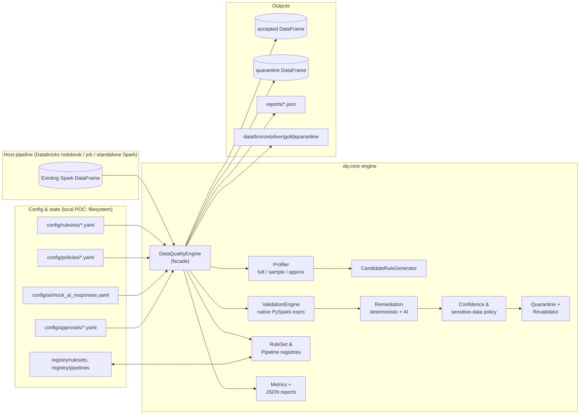
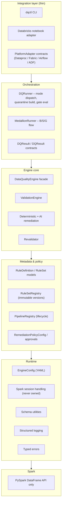
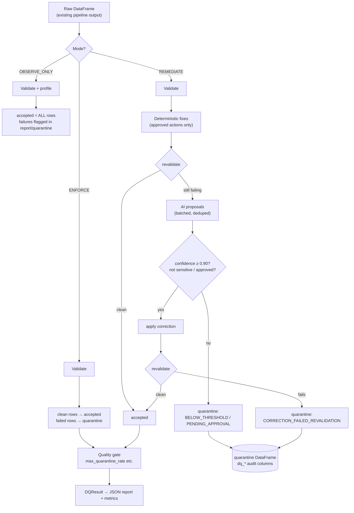

# Architecture — High Level Design & Development Status

> **Current state (verified 2026-11-06):** all 12 checkpoints complete —
> **130 automated tests passing** on local Spark 4.1.3, CLI verified end-to-end,
> expected-results conformance proven. See §7 for the honest done/partial/not-built map.

## 1. Design goals

1. **Drop-in for existing PySpark pipelines** — the engine accepts an existing
   `DataFrame`, uses its own `SparkSession`, and returns DataFrames the pipeline
   continues with. No new Spark application, no session lifecycle ownership.
2. **Portable core** — `dq-core` has zero Databricks imports; the same wheel runs on
   Databricks, Dataproc, Fabric Spark, and standalone Spark.
3. **Metadata-driven, reviewable rules** — rules are versioned, checksummed,
   immutable once published, and every execution records the exact rule set version.
4. **Safe remediation** — deterministic fixes first, AI proposals second, confidence
   threshold (default 90 %), sensitive-column approval gates, mandatory
   post-correction revalidation, quarantine for everything uncertain.
5. **Observable** — every run emits metrics, a JSON audit report and per-record
   quarantine rows with full provenance.

## 2. High-level component map

## 3. Runtime layering

## 4. End-to-end data flow (what actually executes)

## 5. Execution modes

| Mode | Validation | Deterministic fixes | AI proposals | Output effect |
|---|---|---|---|---|
| `OBSERVE_ONLY` | yes | no | collected only | `accepted` = all input rows; failures flagged in quarantine/report; pipeline output unchanged |
| `ENFORCE` | yes | no | no | failing rows → quarantine; clean rows → accepted |
| `REMEDIATE` | yes → revalidate | yes (approved only) | yes (policy-gated) | corrected rows revalidated → accepted; unresolved → quarantine |

Mode resolution order: explicit `mode=` argument → `context.integration_mode` →
`policy.default_integration_mode` → `engine.yaml default_mode` (OBSERVE_ONLY).

## 6. Key data contracts

- **`PipelineContext`** — `pipeline_id`, `pipeline_run_id`, `dataset`, `stage`
  (BRONZE/SILVER/GOLD), `platform`, `runtime`, optional `ruleset_version`,
  `integration_mode`. Every run is traceable to a pipeline run.
- **`DQResult`** — `accepted_dataframe`, `quarantine_dataframe`,
  `validation_results`, `remediation_results`, `execution_metrics`,
  `quality_gate`, optional `final_validation_results`, `profile`, `to_dict()` /
  `write_report()` JSON audit output.
- **`RuleSet`** — immutable once published; `checksum()` over canonical content;
  `derive()` creates a *new* version; registry enforces "no content change under an
  existing version".
- **Quarantine row** — original record + `dq_*` columns: run/pipeline/dataset IDs,
  failed rule IDs, failure reasons, proposed correction, confidence, remediation
  status, timestamps.

## 7. Development status — where we are

### 7.1 Checkpoint tracker (all 12 complete)

| CP | Scope | Status |
|---|---|---|
| 1 | Workspace/env inspection, pinned deps, synthetic pipeline + data | ✅ Done |
| 2 | `dq-core` package skeleton + runtime modules | ✅ Done |
| 3 | Profiling (full/sample/approximate) | ✅ Done + tested |
| 4 | Candidate rule generation + RuleSet models + registry | ✅ Done + tested |
| 5 | Validation engine (native PySpark, multi-violation) | ✅ Done + tested |
| 6 | Deterministic remediation | ✅ Done + tested |
| 7 | MockAIProvider + confidence policy (90 %) | ✅ Done + tested |
| 8 | Quarantine + revalidation + all 3 modes | ✅ Done + tested |
| 9 | Medallion B/S/G + metrics + reports + runner | ✅ Done + tested |
| 10 | Databricks adapter + pipeline registry + `dqctl` + manifests | ✅ Done + CLI-verified |
| 11 | Portability contracts + candidate-rule tests | ✅ Done + contract-tested |
| 12 | Test suite + demo + 15 docs + testing report | ✅ Done (130 tests green) |

### 7.2 Component maturity map

```mermaid
flowchart LR
    subgraph DONE["IMPLEMENTED + TESTED (local Spark)"]
        A1["Profiler"] & A2["CandidateRuleGenerator"] & A3["RuleSet versioning/registry/diff/rollback"]
        A4["ValidationEngine"] & A5["Deterministic remediation"] & A6["MockAIProvider + 90% policy"]
        A7["Quarantine + revalidation"] & A8["OBSERVE/ENFORCE/REMEDIATE"]
        A9["MedallionRunner B/S/G"] & A10["Metrics + JSON reports"] & A11["Pipeline lifecycle registry"]
        A12["dqctl CLI"] & A13["Local Spark harness + Windows FS shim"]
    end
    subgraph CONTRACT["CONTRACT-TESTED ONLY"]
        B1["DataprocAdapter"] & B2["FabricSparkAdapter"] & B3["AirflowCliAdapter"]
        B4["AdfActivityAdapter"] & B5["Databricks notebook pattern"]
    end
    subgraph DESIGNED["DESIGNED, NOT BUILT"]
        C1["SqlAdapter (dbt/Snowflake/BigQuery/Redshift)"] & C2["StreamingAdapter (Kafka/Flink)"]
        C3["Real LLM provider"] & C4["Governance DB / auth / multi-tenancy"]
        C5["UI / REST service"] & C6["Production Airflow/ADF/Dagster/Prefect connectors"]
    end
    DONE --> CONTRACT --> DESIGNED
```

| Area | State | Evidence |
|---|---|---|
| Profiling (FULL/SAMPLE/APPROXIMATE) | ✅ Implemented + 10 integration tests | anomalies, PK candidates, mixed formats detected on real data |
| Candidate rule generation | ✅ Implemented + 19 unit + 2 integration tests | all rule types emit CANDIDATE rules w/ confidence+evidence |
| RuleSet models/versioning/registry | ✅ Immutable publish, checksum verify, diff, rollback | `ImmutableVersionError`, diff 1.0→1.1 verified via CLI |
| Validation engine | ✅ 12 rule types, row+dataset scope, multi-violation | failed-record identification tests pass |
| Deterministic remediation | ✅ 7 actions, audit log, policy-gated | trim/lookup/date/null/dedupe tests pass |
| Mock AI + confidence policy | ✅ 90 % default, boundary-tested 0.89/0.8999/0.90/0.95/1.00 | sensitive columns need approval even @1.00 |
| Quarantine + revalidation | ✅ status taxonomy, `dq_*` columns, post-check | invalid `'IND'` correction caught |
| 3 integration modes | ✅ all tested | OBSERVE 38/38, ENFORCE 16/22, REMEDIATE 24+8/13 |
| Medallion B/S/G | ✅ Bronze preserved, Silver DQ, Gold ref-integrity+biz rules | transactions Gold: 26 acc/4 quar/18 summaries/2,519,147.89 |
| Metrics + reports | ✅ `DQResult.to_dict/write_report`, phase timings | JSON reports verified |
| Pipeline lifecycle | ✅ 7-state machine, offboard keeps data+history | CLI + integration tests |
| `dqctl` CLI | ✅ pipeline/ruleset/run/profile commands | all exercised with real output |
| Local Spark harness | ✅ Spark 4.1.3 + Java 21 + Windows Parquet shim | `check_runtime.py` + 130 tests |
| Portability adapters | 🔶 Contract-tested | `test_portability_contracts.py` 9 tests |
| Databricks execution | ⚠️ Pattern only — **no workspace used** | notebook-style script, not run on Databricks |
| Non-Spark targets (SQL/Flink/etc.) | 📐 Extension contracts only | `docs/pipeline_adapters.md` |

### 7.3 Verified evidence snapshot

- **Tests:** `130 passed in 531s` — unit (metadata, policies, schema, lifecycle,
  candidate-generation) + integration (Spark session, profiling, validation,
  remediation, modes, medallion, pipeline lifecycle, portability).
- **Expected-results conformance:** every per-record outcome in
  `sample_data/expected_results.json` reproduced (customers 38 rows,
  transactions 40 rows, Gold aggregates exact).
- **CLI runs:** OBSERVE_ONLY report, profile JSON, ruleset publish/diff/
  activate/rollback/verify, pipeline onboard→offboard — all real output.
- **Defects found & fixed during verification:** 8 items logged in
  `docs/testing_report.md` §4 (path off-by-one ×2, Spark 4 createDataFrame,
  circular import, ANSI lambda, immutability test, ruleset id, Windows Hadoop).

### 7.4 What remains (honest list)

- Real Databricks workspace run (needs credentials — pattern is ready).
- Real LLM provider behind `AIRemediationProvider` (mock is labelled simulated).
- SQL/streaming adapters, governance DB — later phases by design.
- **PostgreSQL backend** for the registry — SQLite is the embedded impl today
  (`registry.backend: sqlite`); the seam interface means PostgreSQL drops in by
  swapping `RegistryStore` — no caller changes.
- **Job queue for scale-out** — `ui/backend/jobs.py` uses threads + a SQLite job
  store (correct for the in-process SparkSession). Production scale-out = one
  job-runner per cluster behind Celery/RQ/K8s; SSE progress already wired
  (`GET /api/jobs/{id}/stream`).

**New (verified) since §7.3:**
- `validation/engine.py` — REFERENTIAL_INTEGRITY honours `config.join_strategy`
  (`auto` default / `broadcast` / `merge` hint) for large dimension tables.
- `dq_core/registries/` — `factory.py` (backend switch) + `sql_store.py`
  (`SqlRuleSetRegistry`, `SqlPipelineRegistry` overriding only storage seams —
  all immutability/checksum/lifecycle guarantees reused unchanged). Verified:
  publish/verify/diff/immutability + full pipeline lifecycle on SQLite.
- `ui/` — React 18 + FastAPI console: Dashboard, Pipelines (onboard + lifecycle),
  Run DQ (async jobs, SSE real-time progress), Rule Sets, Reports. Jobs persist
  to `data/jobs.db` across restarts.

## 8. Failure & safety model

- Rules are declarative metadata; the validation engine builds **native PySpark
  Column expressions** — no `eval()`, no generated Python/SQL execution.
- Each rule is evaluated independently; a record may accumulate **multiple**
  violations (stored as a list, never collapsed).
- Dataset-level rules (ROW_COUNT, SCHEMA_VALIDATION, REFERENTIAL_INTEGRITY,
  DUPLICATE) are distinguished from row-level rules in results.
- Any correction is revalidated; a correction that still fails → quarantine with
  status `CORRECTION_FAILED_REVALIDATION`.
- Quality gate (`max_quarantine_rate`, `fail_on_dataset_level_errors`,
  `fail_on_not_evaluated_rules`, `min_accepted_records`) decides pass/fail and is
  recorded in metrics + report.

## 9. What is deliberately NOT in this POC

React UI, FastAPI service, PostgreSQL governance store, authentication,
multi-tenancy, real LLM dependency, Databricks workspace automation, production
Airflow/ADF/dbt/Flink/Snowflake connectors. These are extension points documented
in `docs/pipeline_adapters.md`.
