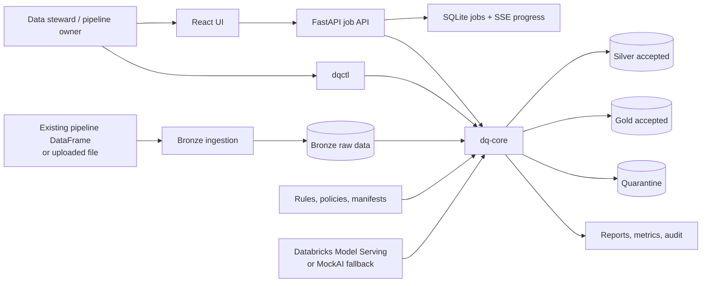
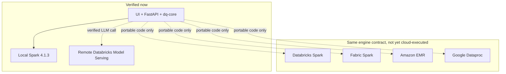
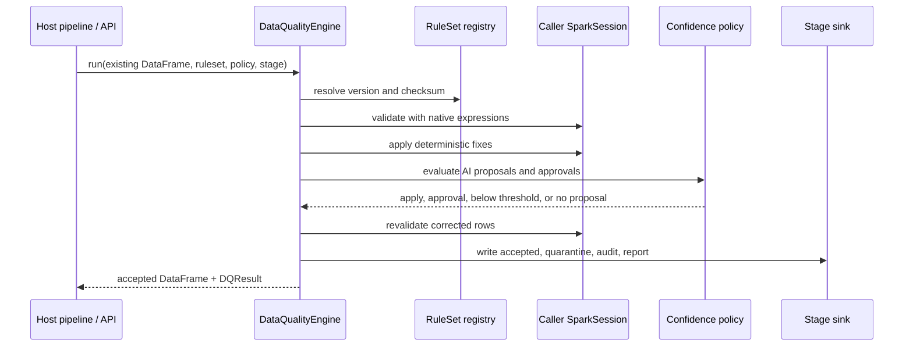
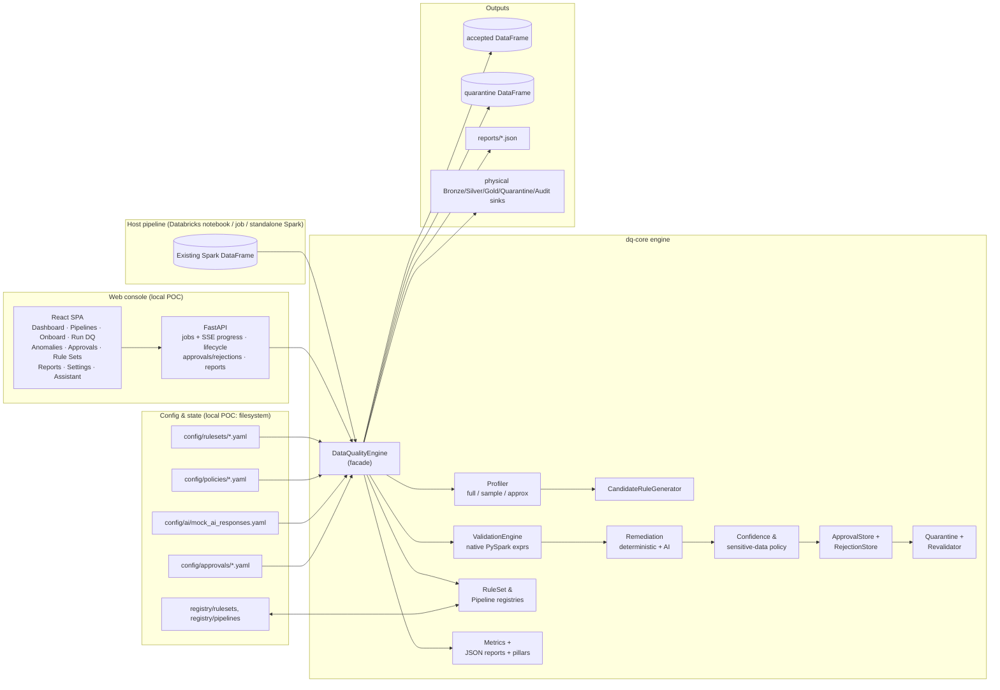
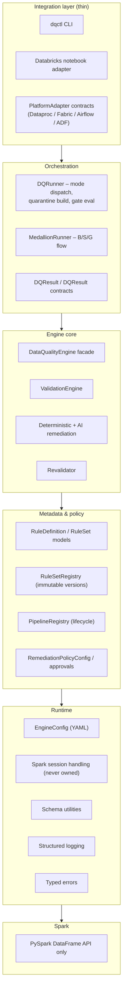
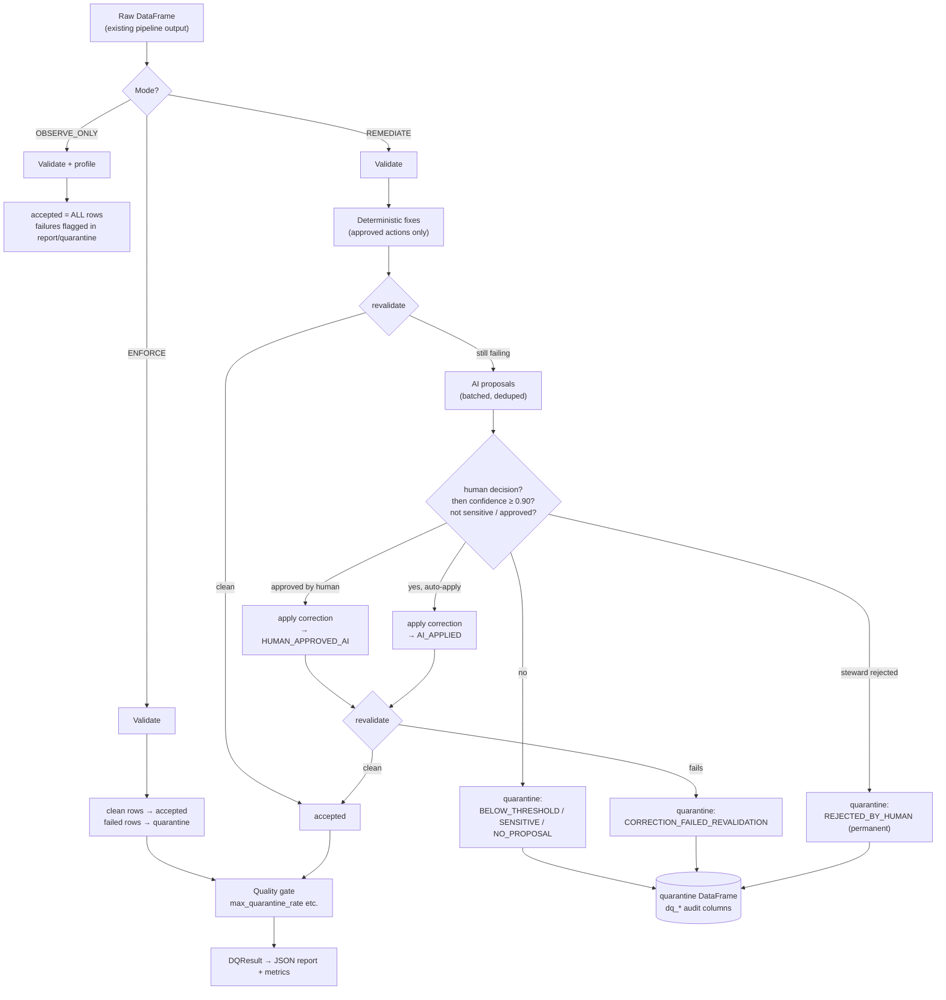

# Architecture — HLD, LLD, and Current POC Status

> **Current state:** local Spark POC is implemented and tested. Real Databricks
> Model Serving remediation is verified. Physical medallion persistence,
> managed Bronze ingestion, seven-pillar scoring, and real cloud Spark runs
> remain prioritized POC work.
>
> **Scope authority:** `docs/POC_CONTEXT.md`. Do not extend into production
> orchestration while P0–P4 in `ROADMAP.md` are open.

## 0. Architecture views

### 0.1 HLD — current POC



All nodes above are implemented and verified on local Spark — including
physical Bronze/Silver/Gold persistence (P0), managed Bronze ingest manifests
(P1), terminal outcome audit (P2), seven quality pillars (P3), and
cross-Spark-version portability evidence (P4).

### 0.2 HLD — deployment boundary



### 0.3 LLD — one stage execution



The sink call is implemented (`StorageSink` + `StoragePaths`): every stage
physically persists accepted/quarantine/audit outputs plus JSON reports.

### 0.4 Persisted layout (as implemented)

```text
data/
  bronze/<dataset>/                  raw landing (parquet) + _ingest.json manifest
  silver/<dataset>/                  accepted Silver output
  gold/<dataset>/                    accepted Gold output
  quarantine/<stage>/<dataset>/      quarantined rows + dq_* provenance
  quarantine/<stage>/<dataset>_removed_duplicates/   dedupe audit rows
  audit/<stage>/<dataset>_remediation_log/           per-record fix/proposal log
reports/
  <dataset>_<stage>_DQRUN-<ts>-<id>.json   execution report (metrics, pillars, outcomes)
registry/
  rulesets/   published immutable ruleset versions (checksum-sealed)
  pipelines/  pipeline lifecycle states + execution history
config/approvals/
  approved_corrections.yaml    steward approvals → HUMAN_APPROVED_AI next run
  rejected_corrections.yaml    steward rejections → REJECTED_BY_HUMAN forever
```

## 1. Design goals

1. **Drop-in for existing PySpark pipelines** — the engine accepts an existing
   `DataFrame`, uses its own `SparkSession`, and returns DataFrames the pipeline
   continues with. No new Spark application, no session lifecycle ownership.
2. **Portable core** — `dq-core` has zero Databricks imports; the same wheel runs on
   Databricks, Dataproc, Fabric Spark, and standalone Spark.
3. **Metadata-driven, reviewable rules** — rules are versioned, checksummed,
   immutable once published, and every execution records the exact rule set version.
4. **Safe remediation** — deterministic fixes first, AI proposals second, confidence
   threshold (default 90 %), sensitive-column approval gates, mandatory
   post-correction revalidation, quarantine for everything uncertain.
5. **Observable** — every run emits metrics, a JSON audit report and per-record
   quarantine rows with full provenance.

## 2. High-level component map



## 3. Runtime layering



## 4. End-to-end data flow (what actually executes)



## 5. Execution modes

| Mode | Validation | Deterministic fixes | AI proposals | Output effect |
|---|---|---|---|---|
| `OBSERVE_ONLY` | yes | no | collected only | `accepted` = all input rows; failures flagged in quarantine/report; pipeline output unchanged |
| `ENFORCE` | yes | no | no | failing rows → quarantine; clean rows → accepted |
| `REMEDIATE` | yes → revalidate | yes (approved only) | yes (policy-gated) | corrected rows revalidated → accepted; unresolved → quarantine |

Mode resolution order: explicit `mode=` argument → `context.integration_mode` →
`policy.default_integration_mode` → `engine.yaml default_mode` (OBSERVE_ONLY).

## 6. Key data contracts

- **`PipelineContext`** — `pipeline_id`, `pipeline_run_id`, `dataset`, `stage`
  (BRONZE/SILVER/GOLD), `platform`, `runtime`, optional `ruleset_version`,
  `integration_mode`. Every run is traceable to a pipeline run.
- **`DQResult`** — `accepted_dataframe`, `quarantine_dataframe`,
  `validation_results`, `remediation_results`, `execution_metrics`,
  `quality_gate`, optional `final_validation_results`, `profile`, `to_dict()` /
  `write_report()` JSON audit output.
- **`RuleSet`** — immutable once published; `checksum()` over canonical content;
  `derive()` creates a *new* version; registry enforces "no content change under an
  existing version".
- **Quarantine row** — original record + `dq_*` columns: run/pipeline/dataset IDs,
  failed rule IDs, failure reasons, proposed correction, confidence, remediation
  status, timestamps.

## 7. Development status — where we are

### 7.1 Checkpoint tracker (all 12 complete)

| CP | Scope | Status |
|---|---|---|
| 1 | Workspace/env inspection, pinned deps, synthetic pipeline + data | ✅ Done |
| 2 | `dq-core` package skeleton + runtime modules | ✅ Done |
| 3 | Profiling (full/sample/approximate) | ✅ Done + tested |
| 4 | Candidate rule generation + RuleSet models + registry | ✅ Done + tested |
| 5 | Validation engine (native PySpark, multi-violation) | ✅ Done + tested |
| 6 | Deterministic remediation | ✅ Done + tested |
| 7 | MockAIProvider + confidence policy (90 %) | ✅ Done + tested |
| 8 | Quarantine + revalidation + all 3 modes | ✅ Done + tested |
| 9 | Medallion B/S/G + metrics + reports + runner | ✅ Done + tested |
| 10 | Databricks adapter + pipeline registry + `dqctl` + manifests | ✅ Done + CLI-verified |
| 11 | Portability contracts + candidate-rule tests | ✅ Done + contract-tested |
| 12 | Test suite + demo + 15 docs + testing report | ✅ Done (130 tests green) |

### 7.2 Current truth and remaining POC work

| Area | State | Boundary |
|---|---|---|
| Local Spark engine and tests | ✅ Verified | 139 tests (74 unit + 65 integration); Spark 3.5.9↔4.1.3 matrix identical |
| UI, CLI, onboarding, lifecycle | ✅ Verified | 9 tabs audited; every action persists + refreshes |
| Real LLM remediation | ✅ Verified | Databricks Model Serving (`simulated=false` per decision); MockAI fallback |
| Medallion chaining + physical persistence | ✅ Verified (P0) | Bronze/Silver/Gold/Quarantine/Audit all written per run |
| Managed Bronze ingestion | ✅ Verified (P1) | `_ingest.json`: checksum, schema, row count per dataset |
| Terminal outcome audit | ✅ Verified (P2) | All 7 outcomes incl. `REJECTED_BY_HUMAN` (rejection memory) |
| Seven-pillar scoring | ✅ Verified (P3) | Pillars + domain recommendations in reports and UI |
| Cross-platform evidence | ◐ Partial (P4) | Platform labels + Spark-version matrix proven; **real cloud Spark run still open — not claimed** |
| Auth, scheduling, adapters, alert delivery | ⏸ Deferred P5 | Do not begin before P4 closes |

### 7.3 Component maturity map

```mermaid
flowchart LR
    subgraph DONE["VERIFIED — P0 to P4"]
        A1["Local Spark engine"]
        A2["UI and CLI onboarding"]
        A3["Rule versioning"]
        A4["Deterministic and real LLM remediation"]
        A5["Quarantine policy + rejection memory"]
        A6["Stage chaining, physical persistence, pillars"]
        A7["Spark 3.5/4.x portability matrix"]
    end
    subgraph OPEN["REMAINING — P4 tail"]
        D1["Real cloud Spark cluster run"]
    end
    subgraph LATER["DEFERRED — P5"]
        E1["Auth and multi-tenancy"]
        E2["Scheduling and orchestration adapters"]
        E3["Alert delivery"]
        E4["Production registry and Kubernetes"]
    end
    DONE --> OPEN --> LATER
```



| Area | State | Evidence |
|---|---|---|
| Profiling (FULL/SAMPLE/APPROXIMATE) | ✅ Implemented + 10 integration tests | anomalies, PK candidates, mixed formats detected on real data |
| Candidate rule generation | ✅ Implemented + 19 unit + 2 integration tests | all rule types emit CANDIDATE rules w/ confidence+evidence |
| RuleSet models/versioning/registry | ✅ Immutable publish, checksum verify, diff, rollback | `ImmutableVersionError`, diff 1.0→1.1 verified via CLI |
| Validation engine | ✅ 12 rule types, row+dataset scope, multi-violation | failed-record identification tests pass |
| Deterministic remediation | ✅ 7 actions, audit log, policy-gated | trim/lookup/date/null/dedupe tests pass |
| Mock AI + confidence policy | ✅ 90 % default, boundary-tested 0.89/0.8999/0.90/0.95/1.00 | sensitive columns need approval even @1.00 |
| Quarantine + revalidation | ✅ status taxonomy, `dq_*` columns, post-check | invalid `'IND'` correction caught |
| 3 integration modes | ✅ all tested | OBSERVE 38/38, ENFORCE 16/22, REMEDIATE 24+8/13 |
| Medallion B/S/G | ✅ Bronze preserved, Silver DQ, Gold ref-integrity+biz rules | transactions Gold: 26 acc/4 quar/18 summaries/2,519,147.89 |
| Metrics + reports | ✅ `DQResult.to_dict/write_report`, phase timings | JSON reports verified |
| Pipeline lifecycle | ✅ 7-state machine, offboard keeps data+history | CLI + integration tests + UI actions |
| `dqctl` CLI | ✅ pipeline/ruleset/run/profile commands | all exercised with real output |
| Local Spark harness | ✅ Spark 4.1.3 + Java 21 + Windows Parquet shim | `check_runtime.py` + test suite |
| Physical medallion persistence (P0) | ✅ Bronze/Silver/Gold/Quarantine/Audit written per run | `written_paths` in API + `data/` tree |
| Managed Bronze ingestion (P1) | ✅ `_ingest.json` checksum/schema/rows per dataset | file inspection per dataset |
| Outcome audit (P2) | ✅ 7 terminal outcomes incl. REJECTED_BY_HUMAN | `outcome_audit` in reports; goat full spectrum w/ real LLM |
| Quality pillars (P3) | ✅ 7 pillars + domain recommendation | report JSON + UI pillar cards |
| Approval + rejection memory | ✅ Approvals → HUMAN_APPROVED_AI; rejections → REJECTED_BY_HUMAN permanently | `config/approvals/*.yaml` + `RejectionStore` + UI decision history |
| Portability (P4) | 🔶 Strong local evidence | platform labels + Spark 3.5.9↔4.1.3 matrix, ANSI on/off — `reports/p4_*_evidence.json` |
| Databricks execution | ⚠️ Pattern + LLM verified — **no workspace Spark run** | Model Serving calls real (`simulated=false`); cluster run open |
| Non-Spark targets (SQL/Flink/etc.) | 📐 Extension contracts only | `docs/pipeline_adapters.md` |

### 7.3 Verified evidence snapshot

- **Tests:** `139 passed` — 74 unit (metadata, policies, schema, lifecycle,
  candidate-generation, remediation outcomes) + 65 integration (Spark session,
  profiling, validation, remediation, modes, medallion, pipeline lifecycle,
  portability).
- **P4 Spark matrix:** byte-identical metrics on the same wheel across
  Spark 3.5.9 ↔ 4.1.3, ANSI enabled/disabled, shuffle partitions 8 ↔ 32 —
  fresh venv containing only the wheel + pyspark
  (`reports/p4_spark_matrix_evidence.json`).
- **AI spectrum (goat, real LLM):** `AI_APPLIED` @0.95, `HUMAN_APPROVED_AI`
  @0.80, `BLOCKED_SENSITIVE_DATA`, `DETERMINISTIC_FIX`, `NO_SAFE_PROPOSAL` —
  every decision `simulated=false`.
- **Expected-results conformance:** every per-record outcome in
  `sample_data/expected_results.json` reproduced (customers 38 rows,
  transactions 40 rows, Gold aggregates exact).
- **CLI runs:** OBSERVE_ONLY report, profile JSON, ruleset publish/diff/
  activate/rollback/verify, pipeline onboard→offboard — all real output.
- **UI audit:** all 9 tabs endpoint-verified; mutating actions persist +
  refresh (Approvals rejection memory fixed and engine-wired).
- **Defects found & fixed during verification:** logged in
  `docs/testing_report.md` §4 plus approval-inbox no-op reject,
  undeclared `click` dependency, CSV `inferSchema` mismatch.

### 7.4 What remains (honest list)

- Real managed-Spark cluster run (Databricks/Fabric/EMR) — engine contract is
  proven portable; execution needs platform credentials (deployment, not engine).
- SQL/streaming adapters, governance DB — later phases by design.
- **PostgreSQL backend** for the registry — SQLite is the embedded impl today
  (`registry.backend: sqlite`); the seam interface means PostgreSQL drops in by
  swapping `RegistryStore` — no caller changes.
- **Job queue for scale-out** — `ui/backend/jobs.py` uses threads + a SQLite job
  store (correct for the in-process SparkSession). Production scale-out = one
  job-runner per cluster behind Celery/RQ/K8s; SSE progress already wired
  (`GET /api/jobs/{id}/stream`).

**New (verified) since §7.3:**
- `validation/engine.py` — REFERENTIAL_INTEGRITY honours `config.join_strategy`
  (`auto` default / `broadcast` / `merge` hint) for large dimension tables.
- `dq_core/registries/` — `factory.py` (backend switch) + `sql_store.py`
  (`SqlRuleSetRegistry`, `SqlPipelineRegistry` overriding only storage seams —
  all immutability/checksum/lifecycle guarantees reused unchanged). Verified:
  publish/verify/diff/immutability + full pipeline lifecycle on SQLite.
- `ui/` — React 18 + FastAPI console: Dashboard, Pipelines (onboard + lifecycle),
  Run DQ (async jobs, SSE real-time progress), Rule Sets, Reports. Jobs persist
  to `data/jobs.db` across restarts.

## 8. Failure & safety model

- Rules are declarative metadata; the validation engine builds **native PySpark
  Column expressions** — no `eval()`, no generated Python/SQL execution.
- Each rule is evaluated independently; a record may accumulate **multiple**
  violations (stored as a list, never collapsed).
- Dataset-level rules (ROW_COUNT, SCHEMA_VALIDATION, REFERENTIAL_INTEGRITY,
  DUPLICATE) are distinguished from row-level rules in results.
- Any correction is revalidated; a correction that still fails → quarantine with
  status `CORRECTION_FAILED_REVALIDATION`.
- Quality gate (`max_quarantine_rate`, `fail_on_dataset_level_errors`,
  `fail_on_not_evaluated_rules`, `min_accepted_records`) decides pass/fail and is
  recorded in metrics + report.

## 9. What is deliberately NOT in this POC

Authentication, multi-tenancy, production Airflow/ADF/dbt/Flink/Snowflake
connectors, Kubernetes deployment, alerting integrations, and real managed-cloud
Spark execution (contract-proven only). The React UI and FastAPI console ARE in
scope as the local POC surface. These are extension points documented
in `docs/pipeline_adapters.md`.
