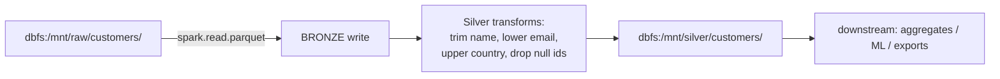

# Databricks Pipeline Assessment

## 1. What was supplied vs. what was created

| Asset | Origin | Status |
|---|---|---|
| `integrations/databricks/customer_pipeline_original.py` | **SYNTHETIC** — created for this POC because no real pipeline code was supplied | Representative Databricks-style PySpark notebook script |
| `integrations/databricks/customer_pipeline_dq_integrated.py` | **SYNTHETIC** — DQ-integrated copy of the above | Runnable pattern; requires a real workspace to execute |
| `config/pipelines/customer_pipeline.yaml`, `transaction_pipeline.yaml` | Synthetic manifests | Registered via `dqctl pipeline onboard` |
| `sample_data/bronze/*.csv` | Synthetic banking data from `scripts/generate_sample_data.py` | Deterministic, defect-mapped |

**No real customer/user pipeline assets were present in the workspace at the start
of the POC.** Per the project brief, a representative Databricks-style PySpark
pipeline was created and is explicitly labelled synthetic everywhere it appears.
Nothing in this repository claims a real pipeline has been integrated.

## 2. Existing pipeline architecture (synthetic "before" state)

`customer_pipeline_original.py` models a typical Databricks notebook job:

- **Source:** Parquet files under a mounted/raw prefix.
- **DataFrames:** `customers_raw` (Bronze), `customers_silver` (Silver).
- **Stages:** BRONZE (raw preserve) → SILVER (light transforms) → implicit GOLD
  (downstream consumers).
- **Existing validation:** none — a `filter(customer_id.isNotNull())` is the only
  guard.
- **Storage:** DBFS/Unity-Catalog-style paths (`dbfs:/mnt/...`).

## 3. Identified datasets

| Dataset | Role | Defects injected (synthetic) |
|---|---|---|
| `customers` | Customer master (Silver) | nulls, whitespace, invalid emails, bad dates, invalid countries/statuses, exact + conflicting duplicates, missing values, AI-proposal cases |
| `transactions` | Transaction fact (Silver) | same families + amount/currency/type defects, negative-but-valid REFUNDs, referential orphans |
| `customer_summary` | Gold aggregate over accepted customers+transactions | derived checks only |

## 4. Safest DQ integration points

The engine is inserted **after** the existing transformations and **before** the
Silver write — the exact point where the pipeline already materialises
`customers_silver`. Minimal diff:

| Step | Original | Integrated |
|---|---|---|
| Build `customers_silver` | unchanged transforms | unchanged transforms |
| DQ call | — | `engine.run(dataframe=customers_silver, …)` |
| Write Silver | `customers_silver.write…` | `dq_result.accepted_dataframe.write…` |
| Quarantine | — | `dq_result.quarantine_dataframe.write…` |
| Downstream | uses `customers_silver` | uses `accepted_dataframe` |

Only **one line of existing code changes** (which DataFrame is written/consumed);
everything else is additive. See `customer_pipeline_dq_integrated.py` — the added
lines are marked `«DQ INTEGRATION»`.

## 5. Proposed DQ integration points (rule sets)

| Stage | Rule set | Purpose |
|---|---|---|
| SILVER | `customers_silver@1.0 / 1.1`, `transactions_silver@1.0` | column-level validity, formats, ranges, duplicates, approved remediation |
| GOLD | `transactions_gold@1.0`, `customer_summary_gold@1.0` | referential integrity vs. customers, business rules (negative REFUND ok, negative PURCHASE not), aggregates, row counts |

## 6. Required code changes for a real pipeline

1. Install/package `dq-core` on the cluster (wheel via cluster library or `%pip install`).
2. `from dq_core import DataQualityEngine, PipelineContext` (1 import).
3. Instantiate engine once per notebook/job from a config path on a UC Volume.
4. Wrap the target `engine.run(existing_df, ruleset=…, policy=…, context=…)`.
5. Route `accepted_dataframe` downstream; persist `quarantine_dataframe`.
6. Optionally `dq_result.raise_if_gate_failed()` to halt on gate failure.

No SparkSession creation, no Databricks REST/Unity-Catalog APIs, no job re-architecture.

## 7. Compatibility notes & assumptions

- **ANSI mode:** local harness sets `spark.sql.ansi.enabled=true` to match
  Databricks Runtime behaviour; the validation engine was fixed for ANSI-safe
  expressions (closure-based severity filters).
- **Python:** engine requires Python ≥3.10; tested on 3.12.
- **Spark:** uses stable DataFrame/Column APIs only (`F.*`, `when/otherwise`,
  `filter`, `agg`); no RDD, no DBUtils, no `spark._jsparkSession` internals.
- **Paths:** on Databricks, `config/engine.databricks.yaml` points `base_path` /
  `reports_path` at a Unity Catalog Volume or `dbfs:` mount — local filesystem
  paths are **not** assumed inside a cluster.
- **Lookups/approvals:** YAML files under `config/` are read via the driver;
  on Databricks they should live on a mounted/UC path readable by the driver.
- **Assumption:** the host pipeline already produces a Silver-stage DataFrame;
  Bronze profiling can also be run via `engine.profile(df, dataset)`.

## 8. Verification status

| Claim | Verified locally | Verified on Databricks |
|---|---|---|
| Engine API works on an existing DataFrame | ✅ (integration tests) | ❌ not executed |
| Notebook-style integration script is syntactically valid | ✅ (py_compile) | ❌ needs workspace run |
| Pipeline manifest lifecycle | ✅ (`dqctl`) | n/a (local registry) |
| Bronze unchanged / Silver / Gold outputs | ✅ (medallion tests) | ❌ |
