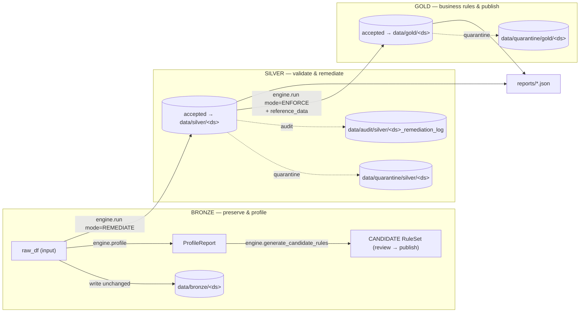

# Medallion Data Flow — Bronze / Silver / Gold

Code: `dq_core/orchestration/medallion.py` (`MedallionRunner`),
`dq_core/io/sinks.py` (`StoragePaths`, `StorageSink`).

> **Status:** stage semantics and chained execution are implemented. The
> backend can run BRONZE → SILVER → GOLD and hand the accepted DataFrame to
> the next stage. Automatic physical persistence of every stage output is
> **P0 and not complete**; do not describe the diagram below as current
> persisted behavior. Target layout is defined in `docs/architecture.md`.

## 1. Stage responsibilities



- **BRONZE** never modifies data: raw rows are written verbatim, profiled, and
  used to *propose* candidate rules (never auto-activated).
- **SILVER** runs the dataset's Silver rule set in the configured mode
  (default `REMEDIATE` for the demo), producing accepted + quarantine +
  remediation audit frames.
- **GOLD** runs the Gold rule set in `ENFORCE` mode **on the Silver-accepted
  frame only**, with `reference_data` (e.g. accepted customers) for
  cross-dataset rules like referential integrity.

## 2. `MedallionRunner.run()` signature

```python
MedallionRunner(engine, paths=StoragePaths(base), sink=StorageSink(...)).run(
    raw_df, dataset,
    pipeline_id=..., pipeline_run_id=...,
    silver_ruleset="customers_silver@active",
    policy="config/policies/default.yaml",
    silver_mode=IntegrationMode.REMEDIATE,
    gold_ruleset="transactions_gold@active",          # optional
    gold_reference_data={"customers": accepted_customers_df},
    profile=True, write_bronze=True, write_silver=True,
    write_gold=True, write_quarantine=True, write_reports=True)
→ MedallionResult(broker/silver/gold DQResults, profile, phase_durations_ms,
                  written_paths, to_dict(), summary_text())
```

## 3. Pipeline-context mapping

| Stage | `PipelineContext.stage` | Mode | Rule set |
|---|---|---|---|
| BRONZE | `BRONZE` | n/a (profile/generate only) | — |
| SILVER | `SILVER` | configured (`REMEDIATE` demo) | `*_silver` ruleset |
| GOLD | `GOLD` | `ENFORCE` | `*_gold` ruleset |

`pipeline_id`/`pipeline_run_id` propagate to every quarantine row and report —
full lineage from raw file to Gold output.

## 4. Gold-level checks demonstrated

`transactions_gold_v1.yaml` + `customer_summary_gold_v1.yaml` include:

- `REFERENTIAL_INTEGRITY` — transaction `customer_id` must exist in the
  Silver-accepted customer set → orphans (`C0099`, quarantined-customer refs)
  land in `data/quarantine/gold/transactions`.
- Business rules — negative `transaction_amount` is **valid for REFUND** but a
  `GOLD_QUARANTINE:BUSINESS_RULE` violation for PURCHASE (configured demo rule;
  negatives are not blanket-rejected).
- `ROW_COUNT` / aggregate sanity — e.g. summary total amount
  `2,519,147.89` over 18 customer summaries (expected value in
  `expected_results.json`).
- `WARNING` severity supported — large-amount transaction passes with a warning
  (counted in metrics, does not quarantine).

## 5. Observed Gold results (transactions pipeline)

```gold.accepted=26 quarantined=4 warnings=1 summary_customers=18
summary_total_amount=2519147.89`` — matching `expected_results.json`.

Gold quarantine reasons observed: `REFERENTIAL_INTEGRITY` (unknown customer,
customer quarantined in Silver) and `BUSINESS_RULE` (negative PURCHASE).

## 6. Reports & metrics

Per stage the runner writes `<dataset>_<stage>_<run_id>.json` containing the
full `DQResult.to_dict()`: execution context (pipeline, ruleset version +
checksum, policy, threshold, engine + runtime versions), validation results,
remediation results, execution metrics, quality gate. A profile report is also
emitted when `profile=True`. Phase durations (`bronze_write`, `silver_dq`,
`gold_dq`, …) are recorded in `MedallionResult.phase_durations_ms`.

## 7. Databricks mapping

The intended cloud mapping changes only storage paths: DBFS or Volumes replace
project-local `data/` paths. This mapping has not yet been executed on real
Databricks Spark compute. P4 must provide that evidence before it is presented
as verified.
